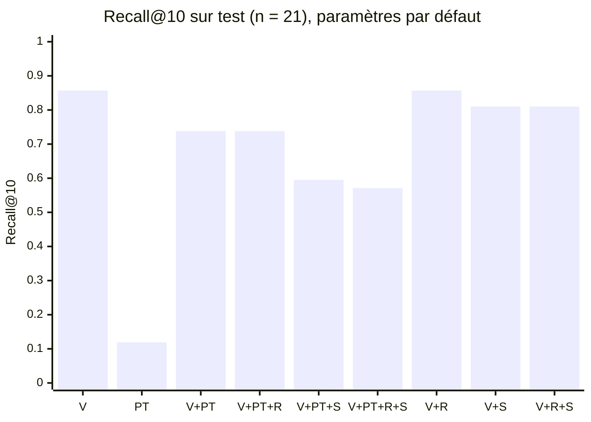

# Rapport R4 — Étape 8 : recherche hybride et évaluation

**Date :** 28 novembre 2026
**Branche :** `etape-8-recherche`
**Statut :** ⚠️ **PROVISOIRE.** Le jeu de scénarios est un brouillon rédigé par
l'IA ; il doit être relu et validé par l'utilisateur avant que les chiffres
soient cités dans le mémoire ou un article.

---

## 1. Question posée

À partir de faits décrits en langage courant, le système retrouve-t-il les bons
articles du Code pénal ? Et la combinaison de plusieurs voies (vecteur, plein
texte, graphe) fait-elle mieux que la recherche vectorielle seule ?

**Hypothèse de départ (docs/PLAN.md) :** l'hybride fait mieux que chaque voie
seule, avec un objectif de Recall@10 ≥ 0,90.

**Réponse courte :** non, pas sur ce jeu. La recherche **vectorielle seule** est
la meilleure configuration (Recall@10 = 0,857 sur `test`, 18/21 scénarios).
Aucune combinaison ne fait significativement mieux ; à poids égal, le plein
texte et le graphe la **dégradent**.

## 2. Méthode

### 2.1 Jeu d'évaluation

| Élément | Valeur |
|---|---|
| Fichier | `data/eval/faits_articles.jsonl` |
| Scénarios | 45, dont 43 évaluables (2 « sans infraction » exclus des métriques) |
| Splits | `dev` 22 évaluables (réglage), `test` 21 évaluables (mesure finale) |
| Catégories | personnes 11, chose publique 10, famille 8, biens 7, intérêt général 4, tentative/complicité 2, plusieurs infractions 1, sans infraction 2 |
| Champs | `attendus` (indispensables), `acceptables` (défendables), `categorie`, `split`, `origine: synthetique` |
| Contrôle | tous les articles cités existent et ne sont ni abrogés ni plages (`scripts/verifier_gold_set.py`) |

**Contrôle anti-biais.** Les scénarios sont écrits en langage courant, sans
reprendre les termes de la loi. Le recouvrement lexical entre les faits et le
texte de l'article attendu (part des racines de mots des faits présentes dans
l'article) vaut : **minimum 0,00, médiane 0,09, maximum 0,40**. Aucun scénario
ne dépasse le seuil de 0,5. Ce choix est voulu : il reproduit la situation d'un
justiciable ou d'un enquêteur qui décrit des faits, pas un juriste qui cite la
loi. Il défavorise mécaniquement le plein texte (§ 5).

### 2.2 Moteur (`search_hybrid.py`)

| Voie | Principe |
|---|---|
| **V** — vectorielle | 20 premiers articles de l'index `article_embedding` (modèle `nvidia/nemotron-3.5-embed-1b:free`, 2048 dimensions, cosinus) |
| **PT** — plein texte | 20 premiers articles de l'index Lucene `article_texte` (analyseur français), requête OU sur les mots pleins, titre pondéré ×2 |
| **R** — renvois | articles reliés par `RENVOIE_A` (deux sens) aux 5 meilleurs articles de V/PT, triés par nombre de liens |
| **S** — voisins | articles sous le même parent (`CONTIENT`) que les 5 meilleurs, les plus proches dans l'ordre du code d'abord |
| **MQ** — multi-requêtes | faits complets + chaque phrase (règles simples, sans LLM) |
| **Fusion** | Reciprocal Rank Fusion pondérée : score = Σ poids / (k + rang) |

Articles abrogés et plages exclus. Chaque résultat garde sa provenance.

### 2.3 Protocole

1. Pré-calcul et mise en cache des 47 vecteurs de requêtes (latences mesurées sans réseau).
2. 11 configurations d'ablation, paramètres par défaut (k = 60, poids 1 pour V et PT, 0,5 pour le graphe).
3. Réglage en grille **sur `dev` uniquement** de trois configurations (k ∈ {10, 30, 60}, poids PT ∈ {0,1 ; 0,25 ; 0,5 ; 1}, poids graphe ∈ {0,1 ; 0,25 ; 0,5}).
4. Mesure finale sur `test`.
5. Statistiques : intervalle de confiance à 95 % par bootstrap (2 000 tirages), test de permutation apparié (10 000 inversions de signe) contre V. Graine fixe (42).

**Transparence sur l'itération.** Une première passe (8 configurations) a été
lancée sur `dev` **et** `test`. La seconde passe a ajouté le poids du plein
texte et les configurations V+R, V+S, V+R+S. Ces ajouts sont motivés par
l'analyse des échecs sur `dev`, où la tendance était la même ; le split `test`
a donc été vu une fois avant le réglage final. Le seul choix final (garder V)
ne dépend pas de `test`.

Commandes :

```text
$ env/bin/python scripts/verifier_gold_set.py
$ env/bin/python evaluate_search.py
```

Résultats bruts : `data/reports/eval_recherche.json` et `data/reports/eval_recherche.md`.

## 3. Résultats

### 3.1 Ablations (paramètres par défaut)

| Configuration | dev R@10 | dev MRR | test R@5 | test R@10 | test MRR | test nDCG@10 | p (R@10 vs V, test) |
|---|---:|---:|---:|---:|---:|---:|---:|
| **V** | **0,727** | **0,449** | 0,738 | **0,857** | **0,648** | **0,747** | — |
| PT | 0,273 | 0,148 | 0,119 | 0,119 | 0,057 | 0,104 | < 0,001 |
| V+PT | 0,682 | 0,265 | 0,500 | 0,738 | 0,244 | 0,412 | 0,245 |
| V+PT+R | 0,591 | 0,254 | 0,357 | 0,738 | 0,219 | 0,389 | 0,245 |
| V+PT+S | 0,591 | 0,195 | 0,262 | 0,595 | 0,156 | 0,282 | 0,031 |
| V+PT+R+S | 0,591 | 0,227 | 0,262 | 0,571 | 0,154 | 0,279 | 0,017 |
| V+R | 0,682 | 0,316 | 0,738 | 0,857 | 0,412 | 0,560 | 1,000 |
| V+S | 0,636 | 0,133 | 0,405 | 0,810 | 0,291 | 0,399 | 0,755 |
| V+R+S | 0,545 | 0,117 | 0,405 | 0,810 | 0,248 | 0,366 | 0,755 |
| V+PT+MQ | 0,636 | 0,254 | 0,500 | 0,738 | 0,244 | 0,412 | 0,245 |
| V+PT+R+S+MQ | 0,636 | 0,233 | 0,262 | 0,571 | 0,154 | 0,279 | 0,017 |

IC95 de R@10 pour V : [0,55 ; 0,91] sur `dev`, [0,71 ; 1,00] sur `test`.

### 3.2 Après réglage sur `dev`

| Configuration réglée | Paramètres retenus | test R@5 | test R@10 | test MRR | test nDCG@10 |
|---|---|---:|---:|---:|---:|
| V (référence) | — | 0,738 | 0,857 | 0,648 | 0,747 |
| V+PT+R+S | k = 30, poids PT 0,25, poids graphe 0,1 | 0,690 | 0,857 | 0,326 | 0,523 |
| V+PT | k = 30, poids PT 0,25 | 0,690 | 0,857 | 0,365 | 0,538 |
| V+R+S | k = 10, poids graphe 0,1 | 0,810 | 0,857 | 0,652 | 0,751 |

Le réglage ramène les hybrides au niveau de V en rappel, mais pas au-delà.
V+R+S réglée améliore R@5 sur `test` (0,810 contre 0,738), mais perd en R@10 sur `dev`
(0,682 contre 0,727) : le gain n'est pas stable.



### 3.3 Chiffres bruts pour V

| Split | Tous les attendus dans le top 10 | Attendu en 1ʳᵉ position | Latence médiane |
|---|---:|---:|---:|
| dev | 16/22 | 6/22 | 15 ms |
| test | 18/21 | 11/21 | 13 ms |

Latences hors calcul de l'embedding de la requête (environ 1 à 5 s via
OpenRouter, mis en cache). Objectif < 500 ms : atteint pour toutes les configurations.

## 4. Analyse des échecs (voie vectorielle)

| Scénario | Attendu | Les 3 premiers obtenus | Lecture |
|---|---|---|---|
| S07 séquestration d'un employé | 291 | 322, 252, 311 | le mot « vol » du scénario attire les infractions contre les biens |
| S11 accusation du maire à la radio | 305 | 318, 184, 319 | le contenu de l'accusation (vol d'argent public) masque l'infraction réelle (diffamation) |
| S12 cambriolage d'une case | 318 | 239, 317, 299 | l'article 318 couvre vol, abus de confiance et escroquerie : un seul vecteur pour trois infractions |
| S27 agent des impôts qui exige de l'argent | 134 | 332, 34, 142 | 142 (concussion) est « acceptable » et trouvé ; 134 manque |
| S29 comptable de mairie | 184 | 138, 314-1, 142 | voisins thématiques (déficit, comptabilité) devant le détournement |
| S34 faux policier | 216 | 206, 209, 218 | 218 (usurpation d'uniforme) « acceptable » trouvé ; 216 manque |
| S39 huile frelatée | 258 | 326, 332, 311-2 | vocabulaire commercial plutôt qu'alimentaire |
| S41 tentative de vol | 318 + 94 | 248, 299, 322 | **0/2** |
| S42 guetteur d'un cambriolage | 320 + 97 | 236, 248, 322 | **0/2** |

**Trois causes se dégagent :**

1. **Les articles « multi-infractions » sont mal représentés par un seul
   vecteur.** L'article 318 définit trois infractions ; son vecteur est une
   moyenne qui ne ressemble vraiment à aucune.
2. **Le contenu des propos se confond avec l'acte.** Dans S11, la recherche
   s'attache à ce que dit la personne (un vol) et non à ce qu'elle fait (une
   diffamation).
3. **Tentative et complicité (Livre I) sont introuvables par les faits**
   (0/2 scénarios). Ces articles généraux ne décrivent aucun fait concret.

## 5. Pourquoi le plein texte et le graphe n'aident pas ici

- **Plein texte.** Les faits en langage courant partagent peu de mots avec la loi
  (recouvrement médian 0,09). La requête OU retient alors des mots fréquents
  (« homme », « argent », « pris ») qui favorisent les longs articles et les
  dispositions générales du Livre I. Fusionné à poids égal, il ajoute surtout
  du bruit en tête de liste (MRR divisé par plus de deux).
- **Graphe.** De nombreux renvois relient une infraction à l'article qui fixe sa
  peine (par exemple 320 → 318). Ils sont utiles pour **compléter** une
  qualification, pas pour **classer**. Les voisins de section sont souvent des
  variantes d'une même infraction : ils prennent la place d'autres articles
  pertinents. Sur les deux splits, V+R n'a récupéré **aucun** article attendu
  manqué par V.
- **Échantillon.** Avec 21 scénarios de test, un écart de 2 scénarios n'est pas
  significatif (IC95 de V : [0,71 ; 1,00]). Une différence plus fine que
  ±0,15 de rappel ne peut pas être établie avec ce jeu.

## 6. Décisions et conséquences pour la suite

1. **Configuration par défaut de la recherche : V seule** pour la phase 3. Le
   plein texte reste disponible en option (utile si l'utilisateur emploie le
   vocabulaire juridique).
2. **Le graphe sert à enrichir, pas à classer.** En phase 3, pour chaque
   article retrouvé, on ajoutera au contexte du LLM les articles reliés par
   `RENVOIE_A` (notamment l'article qui fixe la peine).
3. **Tentative et complicité : traitement par règles en phase 3.** Si les faits
   décrivent un acte interrompu ou une aide apportée, ajouter les articles 94 ou
   97 au contexte, sans passer par la recherche.
4. **L'extraction (Phase 1) peut améliorer la recherche.** Indexer chaque
   **infraction** extraite (ou chaque alinéa) au lieu de l'article entier
   répond directement à la cause n° 1. C'est une expérience à mener après
   l'extraction.

## 7. Pistes d'amélioration (non réalisées)

| Piste | Effet attendu | Coût |
|---|---|---|
| Embeddings par alinéa (627 nœuds `Alinea`) ou par infraction extraite | corrige les articles multi-infractions (S12) | ~630 embeddings gratuits |
| Reformulation des faits par LLM en vocabulaire juridique, puis plein texte | redonne une chance au plein texte | ≈ 0,0002 $ par requête avec DeepSeek V4.1 Flash |
| Reclassement des 20 premiers par un LLM | améliore le MRR | ≈ 0,003 $ par requête |
| Deuxième jeu écrit en vocabulaire juridique (par un juriste) | mesure le plein texte dans son vrai domaine | temps humain |
| Jeu plus grand (≥ 80 scénarios) | IC plus étroits, différences de ±0,1 détectables | temps humain |

## 8. Observations utiles pour l'article

1. **Résultat négatif robuste :** sur un code pénal francophone, avec des faits
   en langage courant, la fusion naïve vecteur + plein texte + graphe fait
   **moins bien** que le vecteur seul (MRR 0,15–0,24 contre 0,65 sur `test`).
   C'est contraire à l'hypothèse courante en Graph-RAG et mérite d'être publié
   avec le contrôle du recouvrement lexical.
2. **Le recouvrement lexical comme variable de contrôle :** mesurer et rapporter
   le recouvrement entre requêtes et documents explique la faiblesse du plein
   texte. Peu de bancs d'essai juridiques le font.
3. **Rôle du graphe :** une part des renvois d'un code pénal relie les
   infractions à leurs peines (à quantifier sur les 271 renvois). Ils servent la **justification** (peine
   encourue) plus que la **recherche**. C'est une distinction utile pour la
   conception des systèmes Graph-RAG juridiques.
4. **Granularité d'indexation :** l'échec sur l'article 318 relie la recherche
   à l'extraction structurée (Phase 1). C'est un argument pour une expérience
   croisée « recherche par article ou par infraction ».

## 9. Ce que l'utilisateur doit faire

1. **Relire les 45 scénarios** dans `data/eval/grille_relecture_scenarios.csv`
   (colonnes « décision », « attendus corrigés », « commentaire »).
2. Après relecture, je relancerai `python evaluate_search.py`. Les chiffres de
   ce rapport seront alors remplacés et le statut « provisoire » retiré.

## 10. Reproductibilité

- Code : `search_hybrid.py`, `evaluate_search.py`, `scripts/verifier_gold_set.py`.
- Tests : `tests/test_search_hybrid.py` (16), `tests/test_evaluate_search.py` (14),
  `tests/test_gold_set.py` (7) ; suite complète : 233 tests, OK (10 échecs attendus hérités).
- Neo4j 2026.10.1 ; vecteurs de requêtes en cache dans `data/cache/requetes_embeddings.json` (non versionné).
- Coût : **0 $** (modèle d'embedding gratuit ; limite de 20 requêtes par minute atteinte, gérée par les nouvelles tentatives automatiques).
